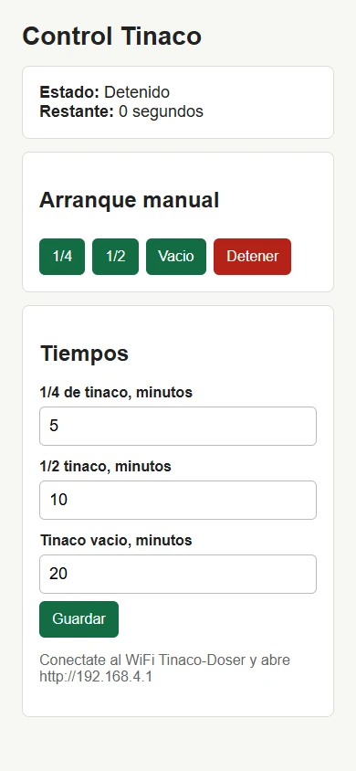
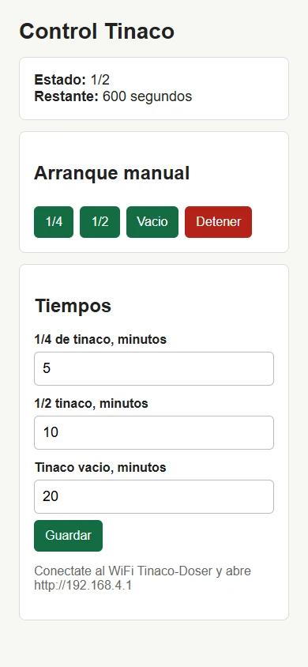
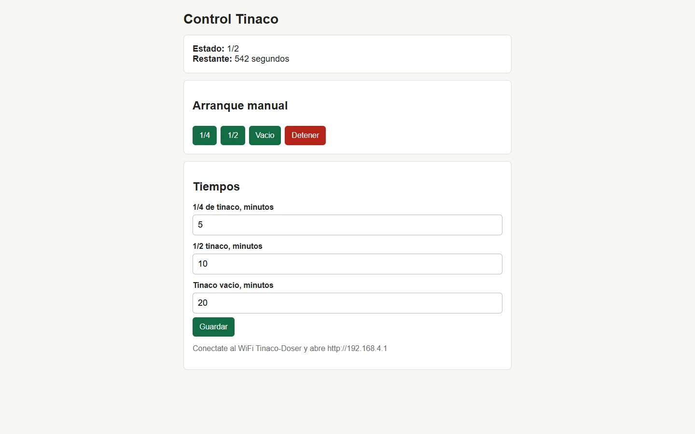
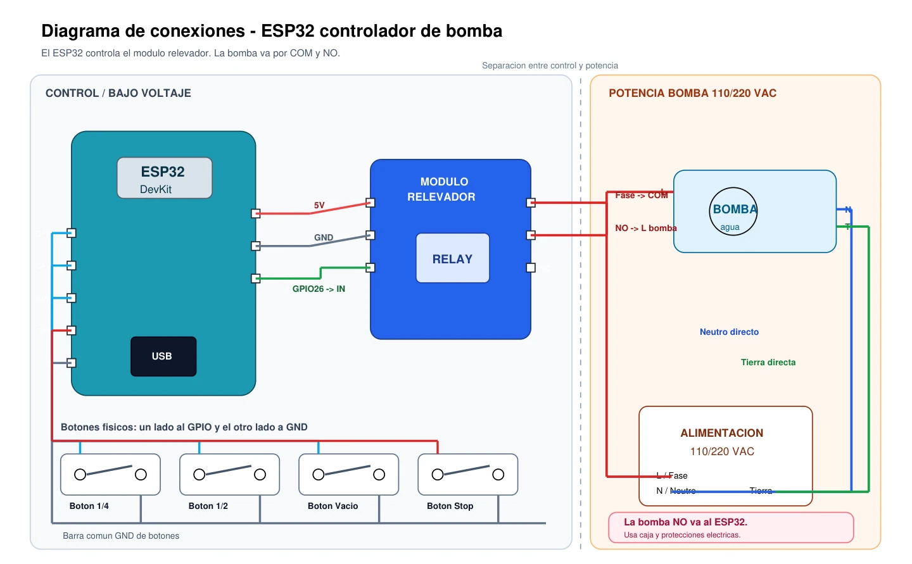
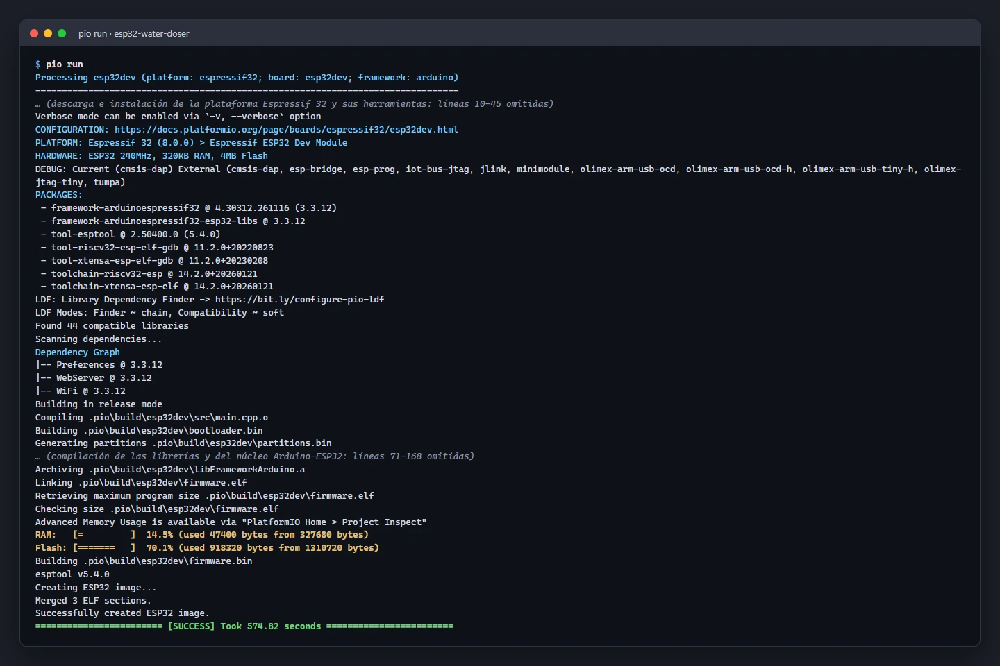

# ESP32 Water Doser

Firmware para ESP32 que enciende la bomba del tinaco durante un tiempo fijo según qué tan vacío esté, y se configura desde el celular con su propia red WiFi.

[](LICENSE)    



## Qué hace

- Crea su propia red WiFi (`Tinaco-Doser`) en modo punto de acceso: no necesita internet ni router.
- Sirve un panel web en `http://192.168.4.1` para arrancar o detener la bomba y cambiar los tiempos desde el celular.
- Tres modos según el nivel del tinaco: **1/4** (5 min por defecto), **1/2** (10 min) y **Vacío** (20 min). Cada tiempo se puede ajustar de 1 a 240 minutos.
- Guarda los tiempos en la memoria no volátil del ESP32 (`Preferences`), así que sobreviven a un apagón o a un reinicio.
- Cuatro botones físicos (1/4, 1/2, Vacío y Detener) con antirrebote de 60 ms, y un LED que indica cuando la bomba está encendida.
- Apaga la bomba sola al terminar el tiempo y muestra en el panel el modo activo y los segundos restantes.
- Compila sin errores con PlatformIO para un ESP32 DevKit: usa el **14.5 % de la RAM** (47,400 de 327,680 bytes) y el **70.1 % de la Flash** (918,320 de 1,310,720 bytes).

## Capturas

| | |
| --- | --- |
|  |  |
| Bomba encendida en modo 1/2, con 600 segundos restantes. | El mismo panel en una pantalla grande. |
|  |  |
| Diagrama de conexiones incluido en `docs/`. | Compilación con PlatformIO y uso de memoria. |

Las capturas del panel se tomaron con datos de demostración: la página (el HTML tal cual del firmware) se sirvió desde un simulador local con la misma lógica y los valores por defecto, porque no había un ESP32 conectado. [Todas las capturas](docs/evidencia/README.md).

## Tecnologías

- ESP32 (placa `esp32dev`) con el framework Arduino
- C++ (`src/main.cpp`)
- Librerías del núcleo Arduino-ESP32: `WiFi`, `WebServer` y `Preferences`
- PlatformIO para compilar y subir
- Python con ReportLab para generar el PDF de conexiones

## Cómo correrlo

### Material

- Una placa ESP32 DevKit y un cable USB de datos.
- Un módulo relevador (o contactor) con capacidad para el voltaje y la corriente reales de la bomba.
- Cuatro botones pulsadores (opcionales; la bomba también se controla desde el panel web).
- [PlatformIO](https://platformio.org): la extensión de VS Code o PlatformIO Core instalado con `pip`.

### Pines por defecto

| Función | Pin ESP32 |
| --- | --- |
| Relevador (`IN`) | GPIO 26 |
| Botón 1/4 | GPIO 32 |
| Botón 1/2 | GPIO 33 |
| Botón Vacío | GPIO 25 |
| Botón Detener | GPIO 27 |
| LED de estado | GPIO 2 |

Los botones van entre el pin indicado y `GND`; el firmware usa `INPUT_PULLUP`. Los pines se cambian al inicio de `src/main.cpp`.

### Relevador

Muchos módulos de relevador azules se activan con la entrada en `LOW`. Por eso el firmware trae:

```cpp
constexpr bool RELAY_ACTIVE_LOW = true;
```

Si tu módulo se activa con `HIGH`, cambia ese valor a `false`.

### Conexiones

Conexión típica de control:

- `5V/VIN` del ESP32 a `VCC` del módulo relevador, si el módulo es de 5 V.
- `GND` del ESP32 a `GND` del módulo relevador.
- `GPIO 26` a `IN` del módulo relevador.

Conexión típica de potencia:

- Fase de la alimentación al común (`COM`) del relevador.
- Normalmente abierto (`NO`) hacia la fase de la bomba.
- Neutro directo a la bomba.
- Tierra física directa a la bomba.

El PDF [`docs/conexiones_esp32_tinaco.pdf`](docs/conexiones_esp32_tinaco.pdf) trae la tabla de pines y el diagrama completo.

### Seguridad eléctrica

- El ESP32 **no** alimenta la bomba: solo controla la entrada del módulo relevador.
- Usa un relevador o contactor con capacidad suficiente para el voltaje y la corriente reales de la bomba.
- La parte de corriente alterna debe quedar en una caja cerrada, con fusible o breaker, tierra física y cableado adecuado.
- Si la bomba es de 110 V o 220 V, pide apoyo a alguien calificado para hacer esa conexión.

### Compilar y subir (Windows, PowerShell)

Si ya tienes la extensión de PlatformIO en VS Code, abre la carpeta del repo y usa sus botones *Build* y *Upload*. Con PlatformIO Core en un entorno virtual de Python, fuera del repo:

```powershell
python -m venv ..\.venv-platformio
..\.venv-platformio\Scripts\Activate.ps1
python -m pip install platformio

pio run                    # compila (la primera vez descarga la plataforma de Espressif y tarda varios minutos)
pio run --target upload    # sube el firmware al ESP32 conectado por USB
pio device monitor         # monitor serie a 115200 baudios (ya configurado en platformio.ini)
```

Al terminar, `pio run` muestra el uso de memoria. Con `espressif32` 8.0.0 (Arduino-ESP32 3.3.12):

```text
RAM:   [=         ]  14.5% (used 47400 bytes from 327680 bytes)
Flash: [=======   ]  70.1% (used 918320 bytes from 1310720 bytes)
```

También puedes copiar `src/main.cpp` a un sketch de Arduino IDE con el soporte para placas ESP32.

En el monitor serie verás `Control de tinaco listo`, el nombre de la red y la dirección del panel, y después un aviso cada vez que la bomba se enciende o se detiene, o se guardan los tiempos.

### Uso

1. Enciende el ESP32.
2. Conéctate desde el celular a la red WiFi `Tinaco-Doser` con la clave `12345678`.
3. Abre `http://192.168.4.1`.
4. Ajusta los minutos para 1/4, 1/2 y Vacío, y toca **Guardar**.
5. Arranca la bomba desde el panel o con los botones físicos; **Detener** la apaga en cualquier momento.

Antes de instalarlo, cambia la clave de la red (`AP_PASSWORD`, mínimo 8 caracteres) y, si quieres, el nombre (`AP_SSID`) al inicio de `src/main.cpp`.

El panel usa estas rutas:

| Ruta | Qué hace |
| --- | --- |
| `GET /` | Panel con estado, tiempo restante, arranque manual y tiempos |
| `GET /start?mode=quarter` · `half` · `empty` | Enciende la bomba en ese modo |
| `GET /stop` | Detiene la bomba |
| `POST /save` | Guarda `quarter`, `half` y `empty` en minutos (1 a 240; un valor fuera de rango se ignora) |

### Regenerar el PDF de conexiones

```powershell
python -m pip install reportlab
python docs\generate_wiring_pdf.py
```

## Estructura

```text
src/main.cpp                       Firmware: red WiFi, panel web, botones, relevador y tiempos
platformio.ini                     Placa esp32dev, framework Arduino y monitor a 115200 baudios
docs/conexiones_esp32_tinaco.pdf   Tabla de pines y diagrama de conexiones
docs/generate_wiring_pdf.py        Script que genera ese PDF con ReportLab
docs/evidencia/                    Capturas del proyecto
```

## Licencia

MIT. Ver [LICENSE](LICENSE).

---

Hecho por [Alexsandro Hernández Vargas (AHV-Dev)](https://github.com/Alexsandro215).
