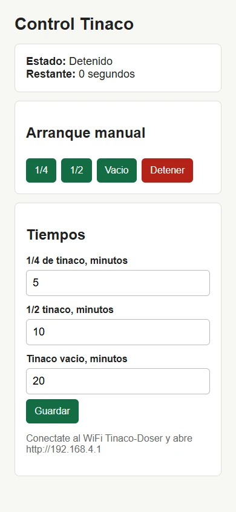
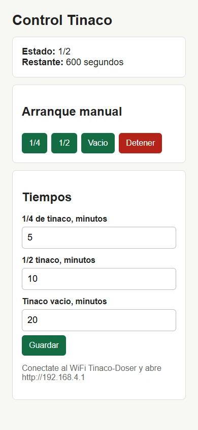
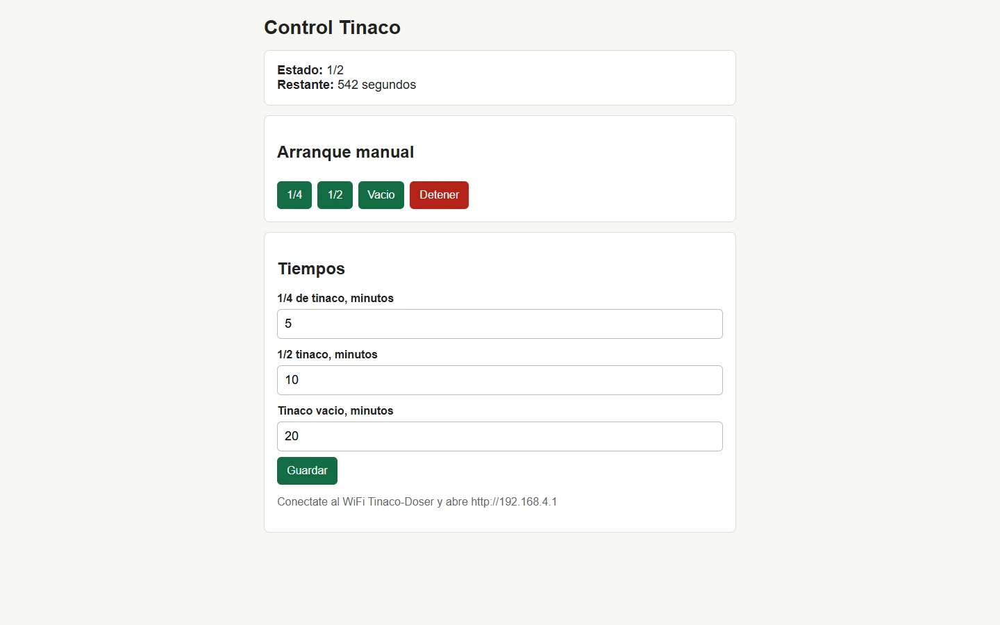
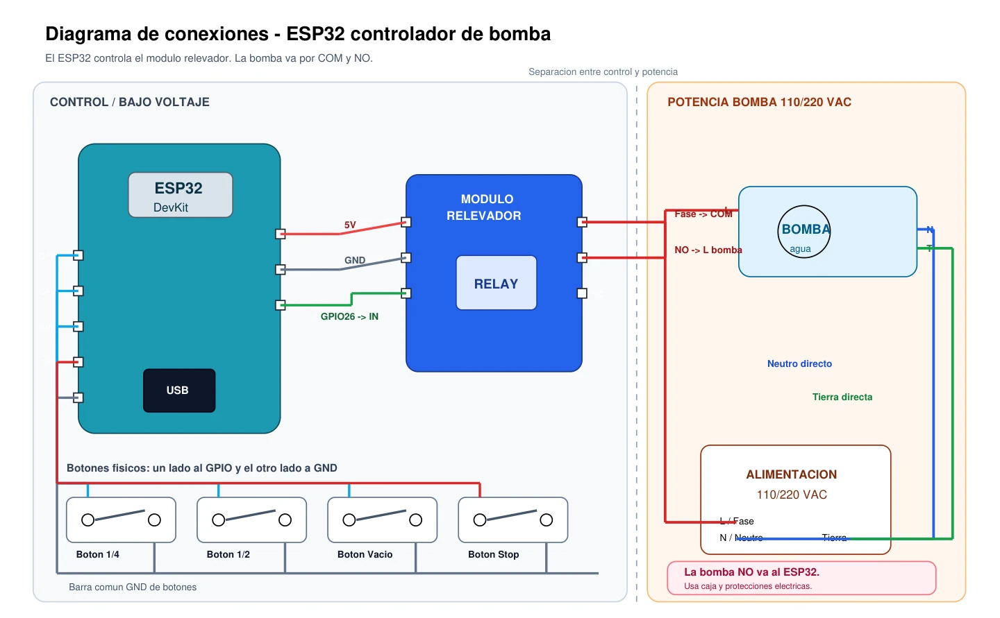
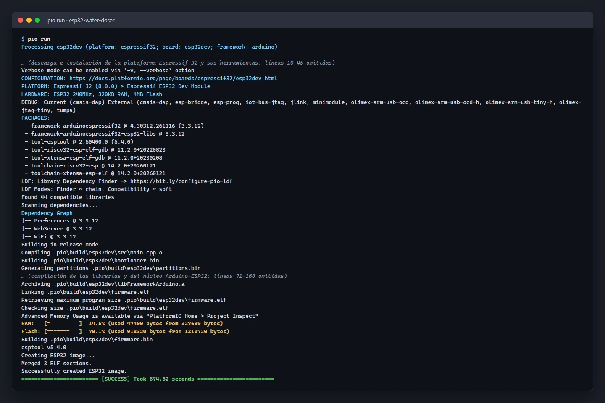

# Evidencia

Capturas reales del programa funcionando, tomadas el 22 de noviembre de 2026 con **datos de demostración**
(nombres, cuentas y cifras inventadas). No contienen datos personales reales.

## 1. Panel de control en el celular

La página que sirve el ESP32 en http://192.168.4.1, vista en un celular: estado de la bomba, arranque manual por nivel del tinaco y los tiempos guardados (5, 10 y 20 minutos, los valores de fábrica del firmware). El HTML y el CSS se extrajeron tal cual del código del firmware.

## 2. Bomba encendida para medio tinaco

Después de tocar «1/2», la página muestra la bomba encendida y la cuenta regresiva de 600 segundos. Las respuestas del ESP32 se simularon en la PC con la misma lógica del firmware, porque no había una placa conectada.

## 3. La misma página en escritorio

El panel se adapta a una pantalla grande sin perder claridad: la bomba sigue en marcha y el tiempo restante va bajando.

## 4. Diagrama de conexiones

Página del PDF de conexiones que incluye el proyecto: el ESP32 solo controla el módulo relevador, y la parte de 110/220 V de la bomba queda separada, con sus protecciones.

## 5. Firmware compilado con PlatformIO

Compilación real del firmware para un ESP32 de 240 MHz: termina sin errores y usa el 14.5 % de la RAM y el 70.1 % de la memoria de programa. El tiempo total incluye la descarga de las herramientas.

